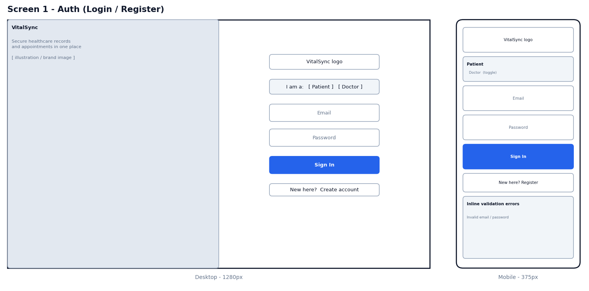
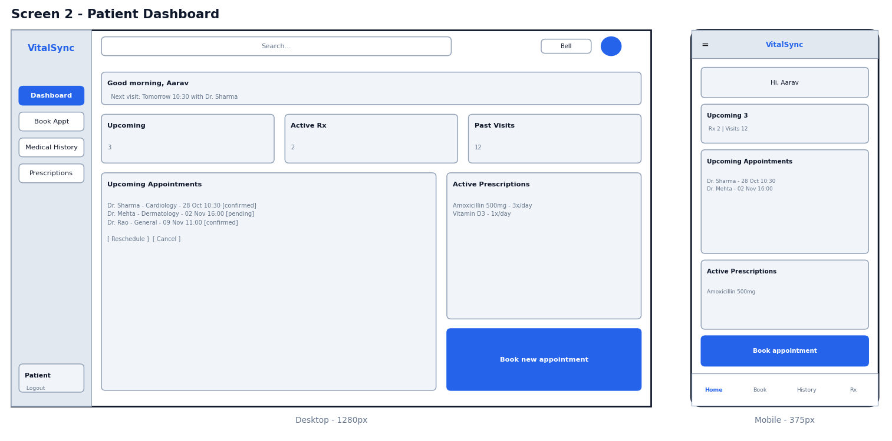
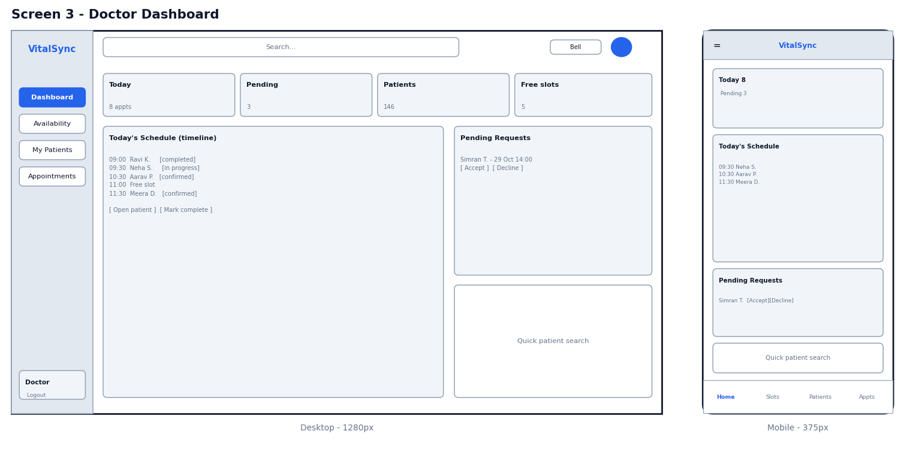
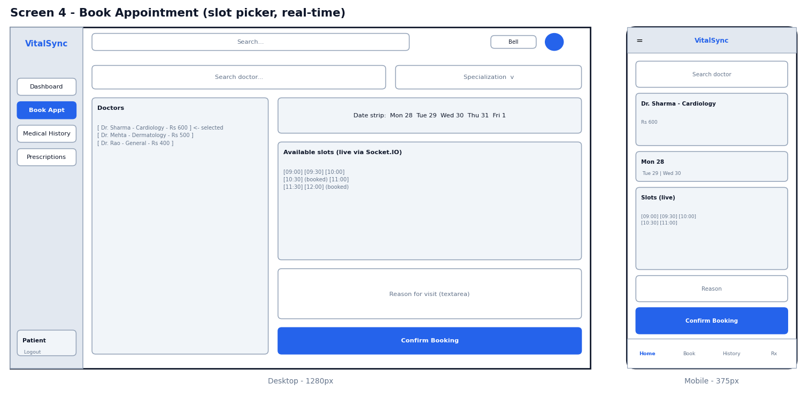
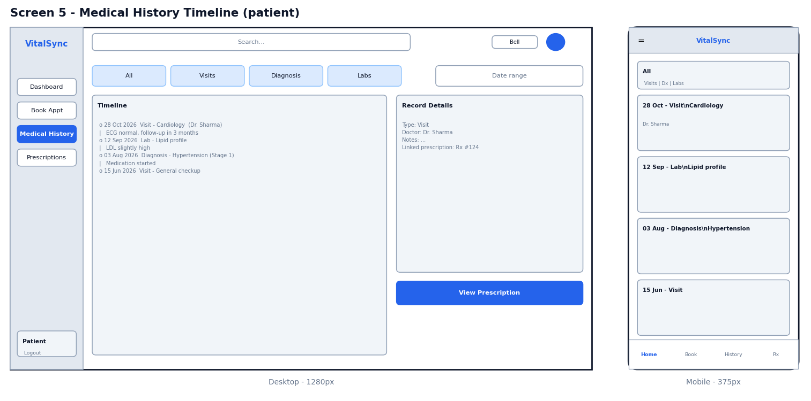
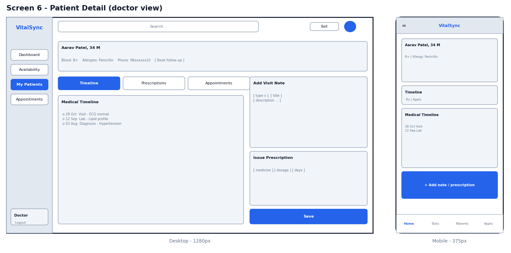
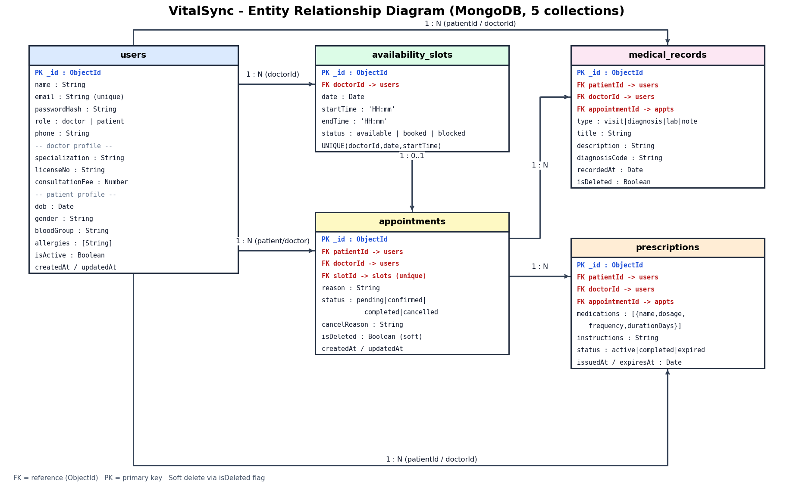

# VitalSync — Healthcare EHR & Appointment Dashboard

> Repository name: `prodesk-capstone-vitalsync`
> **Designated Track:** Fullstack
> **Figma (public link):** https://www.figma.com/design/ds3oRaMg5aWbrmZkEJUXBU/vitalsync-wireframes?node-id=0-1&t=QcdH6ZRfvpbngB2m-1
> **Demo video:** https://drive.google.com/file/d/18xPn7pj2lSbAsCtYDPp5Ah96j7Sr_yWe/view?usp=sharing

---

## 1. Project Overview

VitalSync is a role-based Electronic Health Record (EHR) and hospital management web app. Doctors manage their schedule, patient histories, and prescriptions. Patients book appointments, view their medical timeline, and track prescriptions. Slot availability updates in real time so two patients can never book the same slot.

> **Data policy:** All data is synthetic. No real patient information is used or stored.

### Problem
Clinics lose time to double-booked slots, scattered patient records, and paper prescriptions. VitalSync puts scheduling, history, and prescriptions in one role-aware interface.

### Target Users
| Role | Goal |
|------|------|
| **Patient** | Find a doctor, book/cancel appointments, view own history and prescriptions |
| **Doctor** | Set availability, manage appointments, add visit notes, issue prescriptions |

---

## 2. Tech Stack

| Layer | Technology |
|-------|-----------|
| Frontend | React (Vite), React Router, Tailwind CSS, Shadcn UI |
| State / Data fetching | Zustand (auth/UI state), TanStack Query (server state) |
| Backend | Node.js, Express.js |
| Database | MongoDB Atlas + Mongoose |
| Auth | JWT (access + refresh tokens), bcrypt |
| Real-time | Socket.IO |
| Validation | Zod |
| Tooling | Figma, dbdiagram.io, Postman, ESLint/Prettier |
| Deployment (Sprint 17) | Vercel (client), Render (API), GitHub Actions (CI/CD) |

---

## 3. Core Features (Prioritized)

### P0 — MVP (Sprint 14)
1. **Authentication & RBAC** — register/login, JWT, role guard middleware (`doctor` | `patient`), protected routes on client and server.
2. **Doctor availability management** — doctors define weekly slots.
3. **Appointment booking** — patient selects doctor, date, slot; conflict check prevents double-booking.
4. **Role dashboards** — patient dashboard (upcoming appointments) and doctor dashboard (today's schedule).

### P1 — Feature Completion (Sprint 15)
5. **Appointment lifecycle** — `pending → confirmed → completed | cancelled` with doctor/patient actions.
6. **Medical history timeline** — chronological view of visits, diagnoses, and notes; doctors add entries.
7. **Prescription viewing** — state machine `active → completed | expired`; doctors issue, patients view.
8. **Real-time availability** — Socket.IO pushes slot changes live to all open booking screens.
9. **Soft-delete** — cancelled appointments and removed records are flagged, never hard-deleted.

### P2 — Polish (Sprints 16–17)
10. AI integration: visit-note summarizer for the timeline (doctor-triggered).
11. Search/filter doctors by specialization.
12. Audit log of record access.
13. Optional: payment gateway for consultation fees.

### Explicitly Out of Scope (prevents scope creep)
Video calling, chat, insurance/billing engine, multi-hospital tenancy, file/imaging uploads, admin role.

---

## 4. Functional Requirements (Examples)
- A patient **must not** book a slot already `booked` (atomic update server-side).
- A patient **can only** read their own records; a doctor **can only** read records of patients they have an appointment with.
- A doctor **must be able to** soft-delete (cancel) an appointment with a reason.
- Prescriptions are immutable once issued; changes create a new prescription.

## 5. Non-Functional Requirements
- Mobile-first responsive (375px, 768px, 1280px breakpoints)
- Passwords hashed; JWT expiry 15 min, refresh 7 days
- API input validated with Zod; rate limiting on auth routes
- Accessible: WCAG AA contrast, keyboard navigable

---

## 6. Information Architecture & Routes

| Route | Access | Screen |
|-------|--------|--------|
| `/login`, `/register` | Public | Auth |
| `/patient/dashboard` | Patient | Upcoming appointments, active prescriptions |
| `/patient/book` | Patient | Doctor search + slot picker |
| `/patient/history` | Patient | Medical timeline |
| `/patient/prescriptions` | Patient | Prescription list/detail |
| `/doctor/dashboard` | Doctor | Today's schedule, stats |
| `/doctor/availability` | Doctor | Weekly slot manager |
| `/doctor/patients/:id` | Doctor | Patient detail, timeline, add note/prescription |

---

## 7. UI/UX Wireframes

**Figma (public link):** https://www.figma.com/design/ds3oRaMg5aWbrmZkEJUXBU/vitalsync-wireframes?node-id=0-1&t=QcdH6ZRfvpbngB2m-1

6 core viewports, each designed for desktop (1280px) and mobile (375px). Design system: Tailwind + Shadcn UI, primary `#2563EB`, Inter font.

| # | Screen | Role |
|---|--------|------|
| 1 | Auth (Login / Register) | Public |
| 2 | Patient Dashboard | Patient |
| 3 | Doctor Dashboard | Doctor |
| 4 | Book Appointment (live slot picker) | Patient |
| 5 | Medical History Timeline | Patient |
| 6 | Patient Detail (add note / issue Rx) | Doctor |








---

## 8. System Architecture — ERD



Source: [`vitalsync.dbml`](./vitalsync.dbml) (paste into dbdiagram.io).

### Collections (5)
| Collection | Purpose |
|-----------|---------|
| `users` | Auth identity, role, and embedded role-specific profile |
| `availability_slots` | Doctor time slots with status |
| `appointments` | Booking linking patient, doctor, slot |
| `medical_records` | Timeline entries per patient |
| `prescriptions` | Medication orders with state |

### Key Relationships
- `users (doctor)` 1—N `availability_slots`
- `availability_slots` 1—0..1 `appointments`
- `users (patient)` 1—N `appointments`, `medical_records`, `prescriptions`
- `appointments` 1—N `medical_records`, `prescriptions` (per visit)

---

## 9. Key API Endpoints (Draft)

| Method | Endpoint | Role |
|--------|----------|------|
| POST | `/api/auth/register`, `/login`, `/refresh` | Public |
| GET | `/api/doctors?specialization=` | Patient |
| GET/POST | `/api/slots` | Doctor (POST), All (GET) |
| POST | `/api/appointments` | Patient |
| PATCH | `/api/appointments/:id/status` | Doctor/Patient |
| GET | `/api/records/:patientId` | Owner / treating doctor |
| POST | `/api/records` | Doctor |
| GET | `/api/prescriptions` | Patient/Doctor |
| POST | `/api/prescriptions` | Doctor |

Socket events: `slot:updated`, `appointment:statusChanged`.

---

## 10. Roadmap
| Sprint | Goal |
|--------|------|
| 13 | Blueprint (this document, Figma, ERD) |
| 14 | MVP: auth, RBAC, availability, booking |
| 15 | Lifecycle, timeline, prescriptions, real-time |
| 16 | AI summarizer, UX polish |
| 17 | CI/CD deployment, go-live |

## 11. Risks & Knowledge Gaps
| Risk | Mitigation |
|------|-----------|
| Race conditions on slot booking | Atomic `findOneAndUpdate` with `status: 'available'` filter |
| RBAC leaks | Central middleware + per-route tests |
| Socket.IO scaling/auth | Authenticate socket handshake with JWT; research rooms per doctor |
| Scope creep | Out-of-scope list above is locked |

---

## 12. Setup (planned)
```bash
git clone https://github.com/<username>/prodesk-capstone-vitalsync
cd client && npm install && npm run dev
cd server && npm install && npm run dev
```
Env vars: `MONGODB_URI`, `JWT_SECRET`, `JWT_REFRESH_SECRET`, `CLIENT_URL`.

## 13. Author
Shivesh Mishra — Individual Contributor, Fullstack Track
